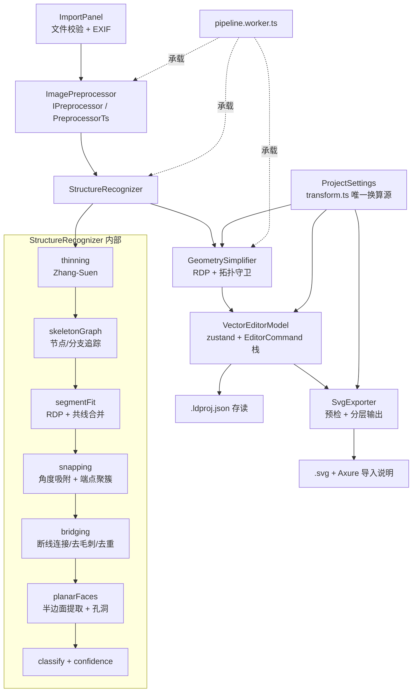

## 用户需求

参考 `Axure_RP_LD_工具设计_Prompt.md` 的设计案约束，在空工作区 `f:/CD_axureRP_LD工具箱` 从零构建一款可直接运行的「手绘 Layout 草图 → Axure RP 可编辑 LD 图形」本地工具。本次交付**可运行的工具代码**（不产出长篇设计文档），全流程打通，其中**结构识别与几何简化内核为投入重点**。

## 产品概述

一款完全本地运行的单页工具应用。用户上传一张手绘地图草图，工具自动识别其中的边界、墙线、分隔线与封闭区域，转换为节点数量合理、拓扑正确的可编辑矢量图形，经人工校正后导出分层 SVG，再由用户导入 Axure RP 并执行「Convert SVG to shapes」得到可编辑形状。

固定流程：`导入草图 → 设置尺寸与比例 → 识别与矢量化 → 可视化校正 → 导出 SVG`，顶部以步骤条串联，各步可自由回退且不丢失已有编辑。

## 核心功能

### 1. 草图导入与预处理

- 支持 JPG/PNG/单页扫描图，校验格式、分辨率与文件大小并给出明确错误原因。
- 自动 EXIF 方向修正、灰度化、对比度增强、阴影抑制、自适应二值化、降噪、去倾斜；支持手动旋转、裁剪、四点透视校正。
- 「原图 / 预处理图」双联预览与滑块对比，每项自动校正均可单独撤销并恢复默认；原始图像始终只读保留。

### 2. 尺寸与比例设置栏

- 区分「地图实际尺寸」（mapWidth / mapHeight / 单位：米、厘米、自定义）与「输出画布像素尺寸」（canvasWidthPx / canvasHeightPx）。
- 默认锁定原图宽高比：改宽自动推高，反之亦然；解锁后允许非等比并显示变形警告。
- 实时显示当前 pixelsPerUnit；支持在图上取两点并输入实际距离完成标定；标定与手动输入冲突时明确提示优先级并提供「采用标定 / 保留手输」选择。
- 提供「恢复原图比例」「重置标定」。修改尺寸或比例后，所有矢量坐标、线宽、吸附阈值、导出坐标按同一变换规则整体更新。

### 3. 结构识别与几何简化（重点）

- 提取线条骨架与轮廓，构建结构图；自动断线连接、短毛刺去除、重复线合并、平行近邻线归并。
- 轻微倾斜线吸附到水平、垂直及常用角度；端点聚簇吸附，保证墙线共享端点。
- 闭合区域检测，区分内外边界并保留孔洞；节点按 RDP 简化。
- 输出时优先采用语义最简几何：方正房间输出为矩形或直线，规则形状输出标准多边形，确实不规则的输出可编辑折线 / 开放路径 / 封闭路径。
- 拓扑守卫：简化前后校验通道未消失、区域未自相交、包含关系未改变；每个对象记录置信度与问题标记。
- 提供快速 / 标准 / 精细三档参数预设及关键阈值微调，可一键重跑。

### 4. 可视化校正编辑器

- 原图、预处理图、矢量结果可分别显示或叠加，底图透明度可调。
- 缩放、平移、框选、多选；图形的选择、移动、新增、复制、删除；节点的移动、新增、删除。
- 开放路径闭合 / 封闭路径打开、路径合并与拆分。
- 网格吸附、端点吸附、角度吸附，按键临时关闭吸附。
- 问题面板高亮低置信度、断线、重叠、异常小图形，点击可定位；支持撤销、重做与「回到自动识别初始结果」。

### 5. Axure 兼容 SVG 导出

- viewBox 与设置的画布像素尺寸严格一致，坐标精度可配。
- 仅使用 line、polyline、rect、polygon 与简单 path；每个逻辑对象拥有稳定、唯一、可读 ID。
- 按「边界 / 墙线 / 封闭区域 / 待确认」分组；样式全内联；不使用滤镜、蒙版、脚本与外部资源；不合并为位图或不可分别选择的复合路径。
- 导出前预检：未闭合区域、越界对象、异常小图形、自相交、坐标非法，逐项可跳转修正。
- 记录地图尺寸、单位、像素比例、工具版本等元数据但不影响显示；内置简短 Axure 导入与转形状说明。

### 6. 项目与隐私

- 项目可保存 / 载入为单个本地工程文件；图像与识别结果全程只在本地处理，不上传、不采集草图内容，无遥测。

## 视觉效果

面向桌面的深色专业工具界面：左侧步骤/图层与参数区，中央大面积画布工作台，右侧检查器与问题列表，顶部步骤进度条与全局操作。青蓝色作为强调色标识可交互控件与选中状态，问题项以琥珀 / 红色标记，整体紧凑、信息密度高、操作反馈即时。

## 一、技术栈

| 层 | 选型 | 理由 |
| --- | --- | --- |
| 构建 | Vite 5 + TypeScript 5（strict） | 零配置、HMR 快、`import ... ?worker` 原生支持 Worker |
| UI | React 18 + Tailwind CSS 3 + shadcn/ui（Radix） | 工具类密集控件（Slider/Popover/Tabs/Dialog/Tooltip）现成可用，深色主题易统一 |
| 状态 | zustand + immer | 轻量、可切片；命令模式的 undo/redo 易于在 store 外部实现 |
| 图像/矢量渲染 | Canvas 2D（分层离屏画布） | 元素量到 2000 时 SVG DOM 会明显掉帧；Canvas 可自控脏矩形重绘与命中测试 |
| 算法内核 | **自研纯 TypeScript**（`src/core/**`），零运行时依赖 | 见下方决策说明 |
| 并发 | Web Worker（`pipeline.worker.ts`）+ 结构化克隆 / Transferable | 识别管线不阻塞 UI，可上报进度与取消 |
| 文件读写 | File System Access API，回退 `<input type=file>` + `Blob` 下载 | 纯前端本地读写，无后端 |
| 工程文件 | `*.ldproj.json`（带 `schemaVersion`，内嵌源图 dataURL） | 单文件便携，可迁移 |
| 测试 | Vitest + 合成样本生成器 | 算法可脱离 UI 单测；合成图直接对应验收标准 |
| 打包 | `vite build` 产出静态资源，`base: './'` 可双击打开；后续可原样套 Electron | 满足「Windows 本地、可与桌面 Axure 配合」 |


### 关键决策 1：OpenCV.js 降级为可选适配层，默认自研 TS 内核

opencv.js 为 8–10MB WASM，安装易失败、首屏加载重，且其 API 无法覆盖本工具最关键的「骨架图 → 平面面提取 → 几何语义分类」环节。本工具所需的积分图自适应二值化、形态学开闭、Zhang–Suen 细化、Moore 边界追踪、RDP、最小外接矩形均可用数百行 TS 精确实现，且便于逐参数单测与调优。
因此在 `src/core/preprocess/IPreprocessor.ts` 定义预处理接口，默认实现 `PreprocessorTs`；未来若需 OpenCV.js，仅新增 `PreprocessorCv` 实现该接口即可替换，不触碰识别与导出层。

### 关键决策 2：坐标系与单一变换源

- **图像像素空间 imgPx**：预处理与识别的工作空间（长边下采样至 ≤2000px，记录 `downscale` 以映射回原图坐标）。
- **地图单位空间 unit（唯一权威存储）**：所有 `VectorElement` 顶点、`strokeWidth`、吸附阈值均以地图单位存储，原点左上、y 向下。
- **画布像素空间 canvasPx**：仅在渲染与导出时由 `pixelsPerUnit = canvasWidthPx / mapWidth` 一次性换算。

这样「修改地图尺寸/画布尺寸 → 所有坐标与线宽按同一规则更新」变成纯粹的标量换算，天然满足验收标准 3 与 7，不存在局部对象比例不一致。`transform.ts` 是唯一换算入口，禁止其他模块自行乘除比例。

### 关键决策 3：闭合区域用「平面图半边遍历」而非填充轮廓追踪

手绘地图的房间大量共享墙线。若对二值图做轮廓追踪，相邻房间会被并成一个连通块。因此在端点吸附后的线段集合上构建平面图（顶点去重 + 边分裂于交点），按「每个顶点出边角度排序 → 取下一条顺时针边」遍历半边，提取所有内部面即为封闭区域；面积最大的外部面丢弃，被完全包含的负向面记为孔洞。
这保证了共享墙的房间被识别为**多个独立矩形**（验收标准 1、6），复杂度 O(E log E)。同时保留 `contourTrace.ts`（Moore 追踪）作为大面积涂黑填充块的降级路径。

### 关键决策 4：几何语义择优输出

对每个面/折线按代价择优：
`rect`（4 点、内角≈90°、边轴对齐，且与最小外接矩形 IoU ≥ 0.97）→ `polygon`（旋转矩形或标准多边形，边长/内角方差在阈值内）→ `polyline` / `openPath` / `closedPath`。
旋转矩形一律导出为 `polygon` 而非 `rect + transform`（Axure 对 transform 的转换行为未验证，标记为风险项，避免坐标漂移）。

## 二、性能与可靠性预算

| 指标 | 目标 | 验证方式 |
| --- | --- | --- |
| 输入上限 | ≤ 25MB，≤ 8000×8000；超限提示并建议压缩 | 导入校验单测 |
| 识别耗时 | 2000px 长边下 ≤ 3s（Worker 内），进度分 6 阶段上报 | `performance.now()` 打点 + 合成样本基准 |
| 元素规模 | 建议 ≤ 2000 个逻辑对象，超出弹出降级提示（提高简化阈值） | 合成密集网格样本 |
| 编辑器帧率 | 2000 元素下平移/缩放 ≥ 50fps | 脏矩形重绘 + 均匀网格空间索引命中测试 |
| 撤销栈 | 上限 100 步，超出丢弃最早项 | 命令栈单测 |
| 内存 | 峰值 ≤ 500MB（源图 + 二值图 + 骨架图共 3 份 Uint8Array，用完即释放） | 手动 profile |


热点控制：二值化使用积分图（O(N)，避免逐窗口求和）；细化使用双缓冲 Uint8Array 与变更标记提前收敛；命中测试与吸附走均匀网格索引（避免每帧 O(n) 全量遍历）；渲染在 `requestAnimationFrame` 内合并脏标记，单帧只重绘受影响图层。

## 三、模块架构

严格遵循 Prompt 指定链路，各模块为纯函数 / 纯类，不依赖 React：



模块契约（错误统一为带 `code` 的 `PipelineError`，不抛裸字符串）：

- `ImagePreprocessor`：入 `SourceImage + PreprocessParams` → 出 `{ binary: Uint8Array, width, height, downscale, warnings }`；错误码 `DECODE_FAILED / TOO_LARGE / UNSUPPORTED_FORMAT / LOW_CONTRAST`。
- `StructureRecognizer`：入二值图 + `RecognizeParams` → 出 `RawStructure{ segments, faces, graphStats }`；错误码 `NO_STRUCTURE_FOUND / TOO_NOISY`。
- `GeometrySimplifier`：入 `RawStructure + imgPx→unit 变换` → 出 `RecognitionResult`；内部拒绝任何破坏拓扑的简化并降级为更低容差重试一次。
- `VectorEditorModel`：持有 `elements / selection / issues / commandStack`，暴露命令化 API；编辑后按 `confidence.ts` 规则重算受影响对象的置信度与问题标记。
- `SvgExporter`：入 `elements + ProjectSettings + ExportSettings` → 出 `{ svg: string, report: PreflightReport }`；预检不通过时返回报告并阻止导出。

## 四、目录结构

```
f:/CD_axureRP_LD工具箱/
├── package.json                 # [NEW] 依赖：react, react-dom, zustand, immer, tailwindcss, radix-ui, clsx, lucide-react；devDeps：vite, typescript, vitest, @vitejs/plugin-react
├── vite.config.ts               # [NEW] base:'./'，@ 别名指向 src，worker.format:'es'，vitest 配置（environment: node 供算法测试）
├── tsconfig.json                # [NEW] strict、noUncheckedIndexedAccess、paths 别名
├── tailwind.config.js           # [NEW] 深色主题 token（primary/surface/warning/danger）、字体族
├── postcss.config.js            # [NEW] tailwind + autoprefixer
├── index.html                   # [NEW] 应用挂载点，中文 lang，字体预连接
├── README.md                    # [NEW] 安装运行说明、Axure 导入步骤、验收清单对照、已知风险与「需验证」项
├── src/
│   ├── main.tsx                 # [NEW] React 根挂载
│   ├── App.tsx                  # [NEW] 步骤路由（import/scale/recognize/edit/export），全局快捷键绑定
│   ├── index.css                # [NEW] Tailwind 指令 + 画布光标/滚动条等基础样式
│   ├── types/
│   │   ├── project.ts           # [NEW] ProjectSettings（mapWidth/Height、unit、canvasWidthPx/Height、lockAspect、pixelsPerUnit、calibration、source）、SourceImage、Unit、Calibration
│   │   ├── vector.ts            # [NEW] Point、LayerKind（boundary/wall/region/review）、VectorElement 判别联合（line/polyline/rect/polygon/openPath/closedPath）、StyleSpec
│   │   ├── recognition.ts       # [NEW] RecognitionResult、RecognitionIssue、IssueType、Severity、PipelineStats、算法版本常量
│   │   ├── editor.ts            # [NEW] EditorCommand 接口、Selection、SnapConfig、ViewportState、ToolKind
│   │   ├── export.ts            # [NEW] ExportSettings（precision、layers、style 默认值、metadata 开关）、PreflightReport
│   │   └── errors.ts            # [NEW] PipelineError 与全部错误码枚举，含面向用户的中文文案映射
│   ├── core/
│   │   ├── geometry/
│   │   │   ├── vec.ts           # [NEW] 向量运算、点线距离、角度归一化、EPS 常量
│   │   │   ├── rdp.ts           # [NEW] Ramer–Douglas–Peucker，支持开放/闭合折线与最小保留点数
│   │   │   ├── lineFit.ts       # [NEW] 最小二乘直线拟合、共线判定、线段合并、平行近邻线归并
│   │   │   ├── polygon.ts       # [NEW] 有向面积、质心、朝向归一、点在多边形内、多边形包含判定、最小外接矩形
│   │   │   ├── intersect.ts     # [NEW] 线段求交、自相交检测（扫描线，退化到 O(n²) 兜底）
│   │   │   └── transform.ts     # [NEW] 唯一换算源：imgPx↔unit↔canvasPx 仿射变换、strokeWidth 换算、坐标精度舍入
│   │   ├── preprocess/
│   │   │   ├── IPreprocessor.ts # [NEW] 预处理接口 + PreprocessParams 定义，声明可替换边界（未来接 OpenCV.js）
│   │   │   ├── decode.ts        # [NEW] createImageBitmap 解码、EXIF 方向修正、长边下采样并输出 downscale 因子
│   │   │   ├── grayscale.ts     # [NEW] 加权灰度、CLAHE 近似的分块对比度增强
│   │   │   ├── integralImage.ts # [NEW] 积分图构建，供自适应阈值 O(1) 窗口求和
│   │   │   ├── adaptiveThreshold.ts # [NEW] Bradley-Roth 自适应二值化 + Otsu 全局兜底 + 对比度过低告警
│   │   │   ├── morphology.ts    # [NEW] 膨胀/腐蚀/开/闭、连通域标记、小噪点面积过滤
│   │   │   ├── deskew.ts        # [NEW] 投影方差法估计倾角并旋正（限 ±15°），超限提示手动校正
│   │   │   ├── perspective.ts   # [NEW] 四点透视矩阵求解与双线性重采样
│   │   │   └── PreprocessorTs.ts# [NEW] 默认实现：按参数编排上述步骤，逐步产出可预览中间图与 warnings
│   │   ├── recognize/
│   │   │   ├── thinning.ts      # [NEW] Zhang–Suen 细化，双缓冲 + 变更标记提前收敛
│   │   │   ├── skeletonGraph.ts # [NEW] 交叉数计算识别端点/交点，追踪分支为像素折线，输出无向图
│   │   │   ├── segmentFit.ts    # [NEW] 分支折线 → 线段/折线：RDP 粗分 + 逐段直线拟合 + 共线再合并
│   │   │   ├── snapping.ts      # [NEW] 角度吸附（0/90/45/30/60，容差可配）、端点并查集聚簇、吸附后重投影保持连接
│   │   │   ├── bridging.ts      # [NEW] 断线端点配对（距离 + 方向连续性）、短毛刺剪除、重复线去重
│   │   │   ├── planarFaces.ts   # [NEW] 平面图构建（交点分裂 + 顶点去重）与半边顺时针遍历提取面、内外边界与孔洞判定
│   │   │   ├── contourTrace.ts  # [NEW] Moore 邻域边界追踪，作为大填充块的降级路径
│   │   │   ├── classify.ts      # [NEW] 择优分类为 rect/polygon/polyline/openPath/closedPath，含 IoU 与边长角度方差判据
│   │   │   ├── confidence.ts    # [NEW] 置信度模型（拟合残差、闭合性、笔画支持度、吸附位移）与编辑后增量重算
│   │   │   ├── topologyGuard.ts # [NEW] 简化前后校验：面积漂移、最小通道宽度、自相交、包含关系变化；违规则降低容差重试
│   │   │   └── StructureRecognizer.ts # [NEW] 编排全部识别步骤，上报阶段进度、统计与 issues
│   │   ├── simplify/
│   │   │   └── GeometrySimplifier.ts # [NEW] 应用 RDP 与拓扑守卫，imgPx→unit 换算，生成最终 RecognitionResult
│   │   ├── export/
│   │   │   ├── SvgExporter.ts   # [NEW] 元素→SVG 元素映射、按 LayerKind 分 <g>、内联样式、稳定 ID、metadata 注入
│   │   │   ├── svgValidate.ts   # [NEW] 导出前预检：未闭合、越界、异常小图形、自相交、NaN/Infinity 坐标，输出可跳转报告
│   │   │   └── axureNotes.ts    # [NEW] Axure 导入与「Convert SVG to shapes」说明文本 + 需验证项清单
│   │   ├── project/
│   │   │   ├── settings.ts      # [NEW] 宽高比锁定推导、pixelsPerUnit 计算、两点标定求解、标定与手输冲突优先级与提示
│   │   │   └── serialize.ts     # [NEW] .ldproj.json 读写与 schemaVersion 迁移，源图 dataURL 内嵌
│   │   └── pipeline/
│   │       ├── params.ts        # [NEW] 快速/标准/精细三档参数预设与阈值取值范围
│   │       └── runPipeline.ts   # [NEW] 预处理→识别→简化的纯函数串联，供 Worker 与单测共用
│   ├── workers/
│   │   ├── protocol.ts          # [NEW] Worker 消息类型定义（run/progress/done/error/cancel）
│   │   └── pipeline.worker.ts   # [NEW] 接收 ImageData 与参数，调用 runPipeline，回传进度与结果，支持取消
│   ├── store/
│   │   ├── useProjectStore.ts   # [NEW] 源图、ProjectSettings、预处理参数、识别参数与运行状态
│   │   ├── useEditorStore.ts    # [NEW] elements/selection/issues/viewport/snap，命令化 mutate 与 undo/redo（上限 100）
│   │   └── commands/index.ts    # [NEW] EditorCommand 具体实现：新增/删除/移动图形、节点增删移、闭合/打开路径、合并/拆分、回到自动结果
│   ├── editor/
│   │   ├── EditorCanvas.tsx     # [NEW] 分层画布容器、指针事件分发、快捷键、光标状态机
│   │   ├── renderer.ts          # [NEW] 底图/矢量/覆盖三层绘制，脏矩形合并，问题高亮与低置信度虚线样式
│   │   ├── spatialIndex.ts      # [NEW] 均匀网格索引，支撑命中测试与吸附候选查询
│   │   ├── hitTest.ts           # [NEW] 图形/节点/边命中判定与框选相交，含容差按缩放自适应
│   │   ├── viewport.ts          # [NEW] 缩放平移矩阵、屏幕↔unit 互转、适应窗口
│   │   ├── snapEngine.ts        # [NEW] 网格/端点/角度吸附求解与吸附参考线输出，支持临时关闭
│   │   └── tools/index.ts       # [NEW] select / node / draw / calibrate 四个工具的状态机实现
│   ├── components/
│   │   ├── layout/AppShell.tsx  # [NEW] 三栏工具布局与深色主题外壳
│   │   ├── layout/StepNav.tsx   # [NEW] 顶部步骤条，含可回退与阶段完成态
│   │   ├── ui/                  # [NEW] shadcn 基础组件（button/slider/tabs/dialog/tooltip/switch/select/scroll-area）
│   │   ├── import/ImportPanel.tsx        # [NEW] 拖拽上传、校验错误提示、旋转/裁剪/透视入口
│   │   ├── import/PreprocessPreview.tsx  # [NEW] 原图/预处理对比滑块、各项自动校正开关与重置
│   │   ├── scale/ScalePanel.tsx          # [NEW] 尺寸比例设置栏全部字段、锁比、pixelsPerUnit 展示、恢复与重置
│   │   ├── scale/CalibrationOverlay.tsx  # [NEW] 画布内两点标定拾取与实际距离输入、冲突提示
│   │   ├── recognize/RecognizePanel.tsx  # [NEW] 参数预设与阈值微调、开始/取消识别、阶段进度与统计
│   │   ├── issues/IssueList.tsx          # [NEW] 问题分组列表、严重度筛选、点击定位并选中对象
│   │   ├── inspector/LayerTree.tsx       # [NEW] 按 LayerKind 分组的对象列表，显隐与锁定
│   │   ├── inspector/ElementInspector.tsx# [NEW] 选中对象类型/坐标/节点数/置信度查看与基础属性编辑
│   │   ├── export/ExportPanel.tsx        # [NEW] 导出设置（精度、图层、样式默认值、元数据）、SVG 预览与保存
│   │   ├── export/PreflightReport.tsx    # [NEW] 预检结果展示，逐项跳转修正，阻止带致命问题的导出
│   │   └── export/AxureGuide.tsx         # [NEW] Axure 导入与转形状步骤说明、需验证风险提示
│   └── lib/
│       ├── id.ts                # [NEW] 稳定可读 ID 生成（如 wall-line-0007），计数器随项目持久化
│       ├── precision.ts         # [NEW] 坐标定精度舍入与浮点比较工具
│       ├── file.ts             # [NEW] File System Access 读写 + 回退下载/上传
│       └── logger.ts            # [NEW] 分级日志（阶段耗时/警告/错误），仅输出尺寸与计数，绝不记录图像内容
└── tests/
    ├── fixtures/synth.ts        # [NEW] 合成样本生成器：方正房间群、共享墙、断线、倾斜线、重复线、不规则区域、带孔洞区域、细通道
    ├── geometry.test.ts         # [NEW] rdp/lineFit/polygon/intersect/transform 单测，含比例变更后坐标与线宽一致性
    ├── preprocess.test.ts       # [NEW] 二值化/形态学/去倾斜在合成图上的正确性与低对比度告警
    ├── recognize.test.ts        # [NEW] 细化、骨架图、断线连接、角度吸附、平面面提取（共享墙 → 多个独立矩形）
    ├── classify.test.ts         # [NEW] 验收标准 1/2：方正房间输出 rect，不规则区域输出 closedPath 且节点可编辑
    ├── topologyGuard.test.ts    # [NEW] 验收标准 4：细通道不因简化消失，自相交被拦截
    ├── commands.test.ts         # [NEW] 验收标准 5：编辑命令的 undo/redo/回到初始结果与置信度重算
    └── svgExport.test.ts        # [NEW] 验收标准 6/7：分组与独立 ID、viewBox 与画布一致、无禁用特性、预检拦截
```

## 五、关键类型契约

```ts
// src/types/vector.ts —— 所有坐标以「地图单位」存储，导出时统一换算
export type Point = { x: number; y: number };
export type LayerKind = 'boundary' | 'wall' | 'region' | 'review';

interface VectorBase {
  id: string;                 // 稳定可读，如 'region-poly-0003'
  layer: LayerKind;
  confidence: number;         // 0..1
  issueIds: string[];
  style: StyleSpec;
  locked?: boolean;
  hidden?: boolean;
  source: 'auto' | 'manual';  // 供「回到自动识别初始结果」区分
}
export type VectorElement =
  | (VectorBase & { kind: 'line'; a: Point; b: Point })
  | (VectorBase & { kind: 'polyline'; points: Point[] })
  | (VectorBase & { kind: 'rect'; x: number; y: number; w: number; h: number })
  | (VectorBase & { kind: 'polygon'; points: Point[]; regular?: boolean })
  | (VectorBase & { kind: 'openPath'; points: Point[] })
  | (VectorBase & { kind: 'closedPath'; points: Point[]; holeOf?: string });
```

```ts
// src/types/editor.ts —— 命令模式，undo/redo 与置信度重算的唯一入口
export interface EditorCommand {
  readonly type: string;
  readonly label: string;                 // 撤销菜单展示
  apply(draft: EditorState): void;
  invert(): EditorCommand;                // 反向命令，避免整状态快照
  affectedIds(): string[];                // 用于增量重算置信度与问题标记
}
```

## 六、实现要点

- **变换单一入口**：任何比例/尺寸相关计算必须经 `core/geometry/transform.ts`，组件与渲染层禁止自行乘 `pixelsPerUnit`，这是验收标准 3、7 不出偏差的根本保障。
- **标定冲突策略**：`settings.ts` 记录 `scaleSource: 'manual' | 'calibration'`。两点标定成功后置为 `calibration` 并提示「已按标定更新地图尺寸」；用户手动改尺寸则切回 `manual` 并将标定标记为 `stale`（保留数据、可一键重新应用），不静默覆盖。
- **不静默出错**：任何阶段的降级（低对比度、倾角超限、无有效结构、简化被拦截）都必须写入 `issues` 并在 UI 可见；`NO_STRUCTURE_FOUND` 时引导进入手动描线工具，绝不输出空白或臆造结果（验收标准 8）。
- **孔洞不用复合路径**：孔洞导出为独立 `polygon/closedPath` 并带 `data-hole-of` 关联，避免 `fill-rule="evenodd"` 复合路径在 Axure 转形状后无法分别选择。
- **旋转矩形不用 transform 属性**：一律展开为 `polygon` 顶点，规避 Axure 对 transform 的未验证行为。
- **Axure 兼容项标注**：`axureNotes.ts` 与 README 明确列出「需真实 Axure RP 验证」的项（stroke-dasharray、fill-opacity、data-* 保留、嵌套 `<g>` 层级、`<metadata>` 忽略），不假设无损转换，不声称可直接生成 `.rp`。
- **Worker 数据传递**：向 Worker 传 `ImageData.data.buffer` 使用 Transferable 避免大数组拷贝；回传仅传结构化的矢量结果与统计，不回传中间位图（预览图在主线程按需从源图重算）。
- **日志与隐私**：`logger.ts` 仅记录阶段耗时、元素计数、错误码，不记录像素数据、文件名或路径；无网络请求、无遥测代码。
- **中文路径兼容**：`vite.config.ts` 设 `base: './'`，脚本避免使用依赖 POSIX 路径的命令，README 说明在 PowerShell 下的 `npm install / npm run dev` 用法。

## 定位

面向 Windows 桌面的**专业级深色工具台**，非营销型页面。信息密度高、控件紧凑、反馈即时，视觉焦点始终在中央画布。参照专业图形/CAD 工具的空间秩序，配以现代化的玻璃质感面板与青蓝辉光强调色，让工具在第一眼即显精密与高级。

## 全局架构

- **顶部条（56px）**：左侧品牌标识与项目名（可内联重命名），中部五段式步骤条 `导入 → 尺寸比例 → 识别矢量化 → 校正 → 导出`，已完成段填充青蓝渐变并带对勾，当前段发光描边，未达段低透明度且不可跳过；右侧为撤销/重做、保存项目、导出主按钮（青蓝渐变 + 轻微辉光）。
- **左栏（280px，可折叠）**：上半为当前步骤的参数区（滑块 + 数值输入联动，滑块轨道带青蓝进度渐变）；下半为图层树，按边界/墙线/封闭区域/待确认分组，每组带计数徽章与显隐、锁定图标。
- **中央画布（自适应）**：深炭底 + 极淡等距网格，画布纸面为略亮矩形并带外阴影与青蓝细描边。左侧悬浮竖排工具条（选择、节点、绘制、标定、平移），底部悬浮状态栏显示缩放百分比、光标坐标（单位与像素双显）、pixelsPerUnit、吸附开关组，全部为磨砂玻璃胶囊。
- **右栏（320px，可折叠）**：上半为检查器（对象类型、节点数、坐标、置信度环形进度条）；下半为问题列表，按严重度分组，条目左侧竖色条标识琥珀/红/蓝，悬停时画布对应区域同步高亮脉冲。
- **底部（可展开抽屉）**：SVG 预览与导出预检报告，问题项可点击跳转。

## 各步骤视觉要点

1. **导入**：空态为大面积虚线拖拽区，中心线稿风格插画与青蓝呼吸光晕；载入后左右并排「原图 / 预处理图」，中间可拖动分隔手柄做对比；下方为各项自动校正的开关行，每行右侧带「重置」文字按钮。
2. **尺寸比例**：字段分为「地图实际尺寸」与「输出画布」两个卡片，中间以锁形按钮连接表示宽高比锁定（锁定态青蓝实心，解锁态灰色并在卡片下方显示琥珀色变形提示）。当前 pixelsPerUnit 以等宽数字大字号强调。两点标定按钮激活后画布进入拾取态，两点间显示带箭头的测量线与输入气泡。
3. **识别矢量化**：三档预设为分段控件；运行时顶部出现细进度条并在画布上以扫描光带动效表示处理阶段，右栏实时累加统计（线段数、区域数、平均置信度、简化率）。
4. **校正**：矢量描边按图层着色（边界青蓝加粗、墙线浅灰、区域半透明蓝填充、待确认琥珀虚线）；选中对象显示节点方块与包围框，节点悬停放大；吸附命中时出现洋红参考线与端点脉冲圈。
5. **导出**：设置项分组卡片，右侧为带语法高亮的 SVG 代码预览；预检通过显示绿色对勾横幅，存在致命问题则显示红色横幅并禁用保存按钮。

## 动效

仅使用不干扰精度的微交互：面板折叠 200ms ease-out，按钮悬停边框辉光 150ms，步骤切换内容淡入上移 12px，问题条目悬停时画布高亮 800ms 脉冲两次，识别扫描光带循环渐变。画布交互本身零动画延迟，保证拖拽跟手。

## 响应式

以 1440×900 为基准；≥1920 时中央画布优先获得额外空间；<1280 时右栏自动折叠为图标条，可点击浮出；<1024 显示「建议在更大屏幕使用」提示但仍可操作。